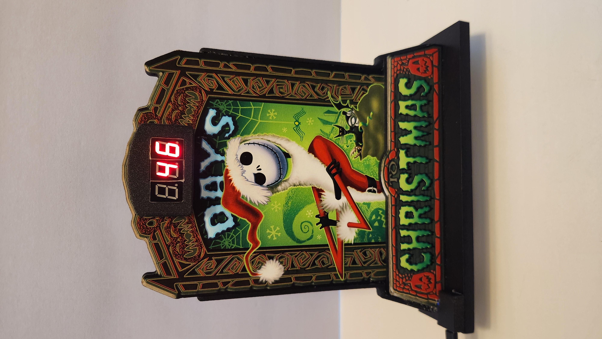
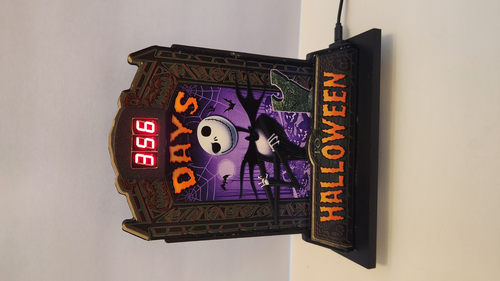
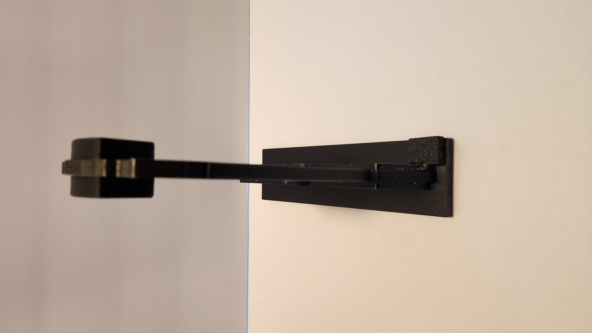
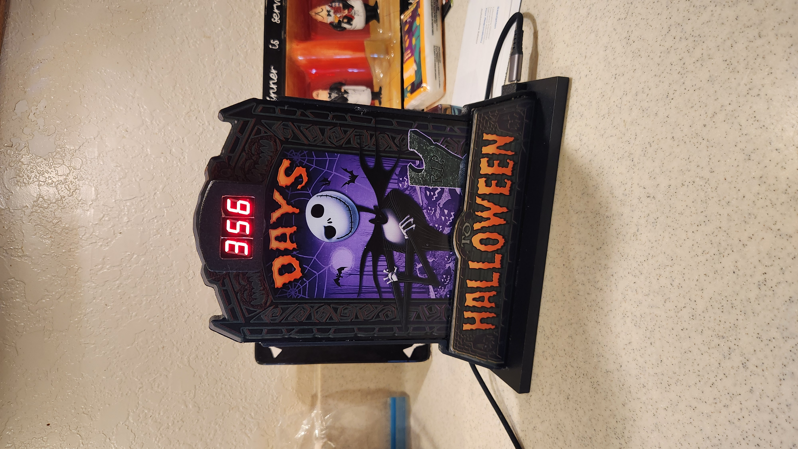
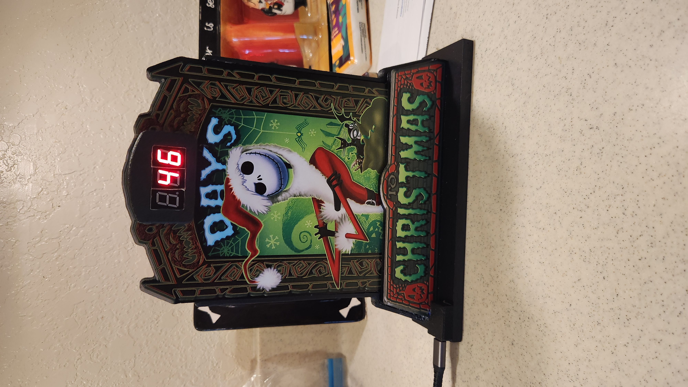

<h1>
  
  Dual Holiday Countdown Display
</h1>
 

A modified Spirit Halloween *The Nightmare Before Christmas Reversible Countdown Calendar*, upgraded with two independently controlled digital countdown displays for Halloween and Christmas.

The project uses a microcontroller to keep both countdowns synchronized with the current date and time. Choose to illuminate the Halloween display, the Christmas display, or both.

---

## Project Photos

  
  &nbsp;&nbsp;
  

  
  &nbsp;&nbsp;
  

  

---

## User Guide

The online guide provides setup instructions and explains how to use the display.

- [View the Online User Guide](https://planedoctor.github.io/NBC_Dual_Holiday_Countdown_Display/)
- [Download the PDF User Guide](User%20Guide/Dual_Holiday_Countdown_User_Guide_Final.pdf)

## Firmware Updates

The latest firmware is available from the project's GitHub Releases page.

- [Download the Latest Firmware](https://github.com/planedoctor/NBC_Dual_Holiday_Countdown_Display/releases)

Firmware update instructions are provided with each update.

## Support

Need help with your Dual Holiday Countdown Display? Have a question or encountered a problem?

Contact HomeHackery at **[HomeHackery1@gmail.com](mailto:HomeHackery1@gmail.com)**.

We're happy to help!

---

  <strong>HomeHackery</strong> 
  <em>Because "Stock" is Boring.</em> 
  <a href="https://www.youtube.com/@TheHomeHackery">HomeHackery on YouTube</a>

